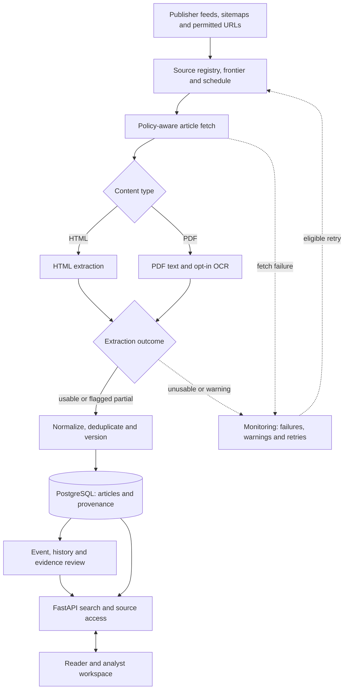

# NewsSources

**Project website:** [Explore the NewsSources showcase](https://himanshu051116.github.io/NewsSources/) — a static, interactive fictional case study. The live FastAPI backend is not hosted on GitHub Pages.

NewsSources is a local news-research application for collecting articles, retaining their revisions, grouping coverage of the same event, and reviewing claims against stored material. The reader, source-management interface and analyst workflows run on a FastAPI backend.

The project is designed for source tracing and editorial research. An article citation records where a statement came from; it does not establish whether that statement is true or independently confirmed.

## Processing flow

This is the main path from a discovered URL to an analyst's investigation. Failures and incomplete extraction are recorded rather than silently treated as successful articles.



See the [pipeline walkthrough](docs/PIPELINE_OVERVIEW.md) for failure handling and [implemented architecture](docs/IMPLEMENTED_ARCHITECTURE.md) for links to the relevant modules. The graph depicts the main processing path, not a guarantee that every source fetch succeeds. PDF/OCR output and source links are reviewable evidence locations, not factual verification.

## What is implemented

| Area | Available workflow |
| --- | --- |
| Source acquisition | Register publishers; discover feed, sitemap and page channels; inspect polling and extraction outcomes. |
| Article records | Store URLs, capture/publication times, extracted text and successive article versions. |
| Event review | Inspect proposed links between articles, including potential duplicates and later corrections. |
| Claims and evidence | Review extracted claims, cited passages, source lineage and unresolved or conflicting evidence. |
| Historical research | Search stored earlier coverage and configured archive/retrieval providers. |
| PDF documents | Extract bounded per-page text; retain page references and partial-extraction warnings. Scanned-page Hindi/English OCR is opt-in. |
| Analyst workspace | Save investigations, notes, searches and evidence-linked briefings. |

PDF table rows and OCR text are marked for review, not accepted as verified facts. Page anchors identify extraction locations rather than independent corroboration.

## Run locally on Windows

Prerequisites: **Python 3.12–3.14 (64-bit), Docker Desktop and PowerShell**. Run from a checkout:

```powershell
git clone https://github.com/himanshu051116/NewsSources.git
cd NewsSources
Set-ExecutionPolicy -Scope Process Bypass
.\scripts\bootstrap.ps1
.\scripts\run-platform.ps1 start
```

On the first run, `bootstrap.ps1` creates `.env` and `.env.local` if missing. The latter contains a generated session secret and enables **local development authentication bypass**. Existing environment files are preserved. This setup must not be exposed publicly or used as production authentication.

Check readiness after startup with `Invoke-WebRequest http://127.0.0.1:8010/api/v1/health/ready`. An empty reader is normal until approved publisher sources have been configured and collected.

Open the local tools:

| Page | Address |
| --- | --- |
| Reader | http://127.0.0.1:8010/news |
| Source operations | http://127.0.0.1:8010/news-sources |
| Historical research | http://127.0.0.1:8010/historical-research |
| API reference | http://127.0.0.1:8010/docs |

Diagnostics and shutdown:

```powershell
.\scripts\run-platform.ps1 status
.\scripts\services.ps1 doctor
.\scripts\run-platform.ps1 stop
```

See [Windows setup](SETUP-WINDOWS.md) for troubleshooting and [the production runbook](PRODUCTION-RUNBOOK.md) for deployment requirements. Starting the local services does not automatically populate the database with news articles; sources must be configured and successfully fetched.

## Investigation workflow

1. Register a publisher, review the discovered channels and check fetch outcomes.
2. Open an article record and compare extracted text with its source URL and timestamps.
3. Inspect related-event candidates; separate duplicate or syndicated reports from independent coverage.
4. Review claims against source passages and earlier versions. Keep unclear claims unresolved.
5. Save the investigation, including source references and any correction history.

The [fictional editorial case](examples/README.md) illustrates a shared original notice, derivative reports and a corrected figure. It is a worked example, not a collected news story.

## Repository layout

```text
backend/src/newsintel/
  adapters/          # acquisition, extraction and external providers
  application/       # article, search and workspace workflows
  domain/            # event, claim and evidence rules
  infrastructure/    # persistence and database access
  api/               # HTTP endpoints and reader pages
  workers/           # polling, extraction and background tasks
backend/migrations/  # Alembic database revisions
backend/tests/       # unit and integration tests
config/              # publisher candidate configuration
qa/                  # replay, audit and evaluation commands
docs/                # current technical guides and archived design notes
```

PostgreSQL holds structured records. Object storage, vector search and browser rendering are separately configured components; see the setup and architecture documentation for their respective requirements.

## Data and evaluation

- [Source configuration](config/README.md): candidate publisher endpoints that still require individual availability, terms, robots and retention review before use.
- [Event-pair test fixtures](backend/tests/fixtures/accuracy/README.md): 20 constructed same-event/different-event pairs used for regression testing, not independently labeled reporting.
- [Event corpus workflow](docs/EVENT_CORPUS_WORKFLOW.md): an offline admission tool for permissioned article captures, capture hashes, independent review and train/test separation.
- [Provenance and evaluation notes](docs/DATA_AND_EVALUATION.md): how publisher records, captured content and test examples are distinguished.

The repository does not ship a representative, independently reviewed real-world accuracy benchmark. The existing evaluator can score an appropriately collected and labeled corpus.

## Development checks

After local bootstrap:

```powershell
.\.venv\Scripts\python.exe -m pytest backend/tests/unit
.\.venv\Scripts\python.exe qa/validate_repository_data.py
.\scripts\services.ps1 doctor
```

CI runs PostgreSQL integration tests, Windows compatibility, S3-compatible storage checks, release integrity and a Docker build. Inspect the [current `main` workflow results](https://github.com/himanshu051116/NewsSources/actions?query=branch%3Amain); a passing build does not measure real-world publisher coverage or editorial accuracy.

## Known limitations

- Publisher markup and feed availability change; acquisition needs source-by-source monitoring.
- Event matching and claim review can be wrong when reports share names, locations, numbers or an original information source.
- OCR quality, PDF tables and page citations need independent review on varied real documents.
- A production deployment requires verified publisher permissions, authentication, backup/restore testing and extended live-source trials. See [current project status](docs/STATUS.md).

## License and reuse

The package metadata declares this project **proprietary**, and the repository does not include a `LICENSE` file. Public source visibility does not grant rights to copy, modify or redistribute it. Contact the maintainer before reuse.

## Further reading

[Implemented architecture](docs/IMPLEMENTED_ARCHITECTURE.md) · [Documentation index](docs/README.md) · [Acquisition design](docs/ACQUISITION_ARCHITECTURE.md) · [Historical research](docs/HISTORICAL_RESEARCH.md) · [Proposed architecture (June 2026)](docs/ARCHITECTURE.md) · [Engineering history](docs/archive/README.md)
