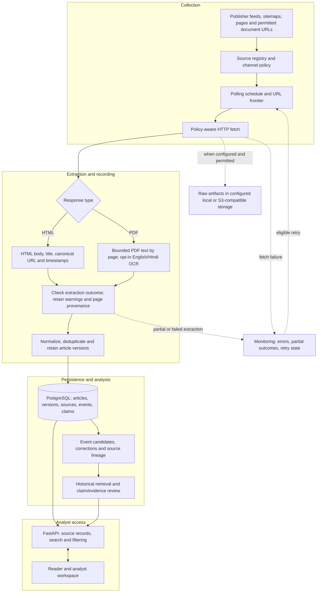

# Collection and processing pipeline

This diagram describes the **merged code path at a functional level**, not a claim that every publisher is currently reachable or that an operational news archive has been populated. It is based on the repository's source registry, collection workers, HTML/PDF extraction, PostgreSQL models, event/claim workflows and FastAPI reader.

## End-to-end flow

## Operational boundaries

- **Discovery is not capture.** Feeds and sitemaps supply candidate URLs; policy, fetching and extraction determine whether a readable article enters the database. Source rights and retention decisions remain operator responsibilities.
- **HTML and PDF have different extraction paths.** PDF processing preserves page information and can optionally attempt OCR. An OCR result, table candidate or source-page link does not verify what a document asserts.
- **Normalization is not fact checking.** Duplicate detection, version history and canonical URLs describe content identity and change. The system can preserve several reports that share one underlying source.
- **PostgreSQL is the structured system of record.** Raw document artifacts may live in configured local/S3-compatible storage. Optional retrieval/vector services are omitted from this overview because they are not required for every local configuration.
- **Failures do not enter the successful path silently.** Fetch/retry outcomes and incomplete extractions are tracked. Retries follow eligibility and limits rather than looping indefinitely.
- **Research and serving are distinct.** Event identity, historical retrieval and claim review use stored records. The API serves those records to the reader; it does not turn a cited passage into an independently confirmed claim.

For more detail, see [acquisition policy](ACQUISITION_ARCHITECTURE.md), [event and evidence design](EVENT_INTELLIGENCE_ARCHITECTURE.md), [source data and evaluation](DATA_AND_EVALUATION.md), and the [production runbook](../PRODUCTION-RUNBOOK.md).

### Why this layout

The three supplied diagrams each capture part of the workflow. The simplest vertical version is the clearest README starting point, but it omits the HTML/PDF split, failure handling and article-version provenance. The more detailed versions contain useful branches but introduce crossing arrows and ambiguous recovery loops. This version keeps a readable primary path while isolating optional services and operational errors.
